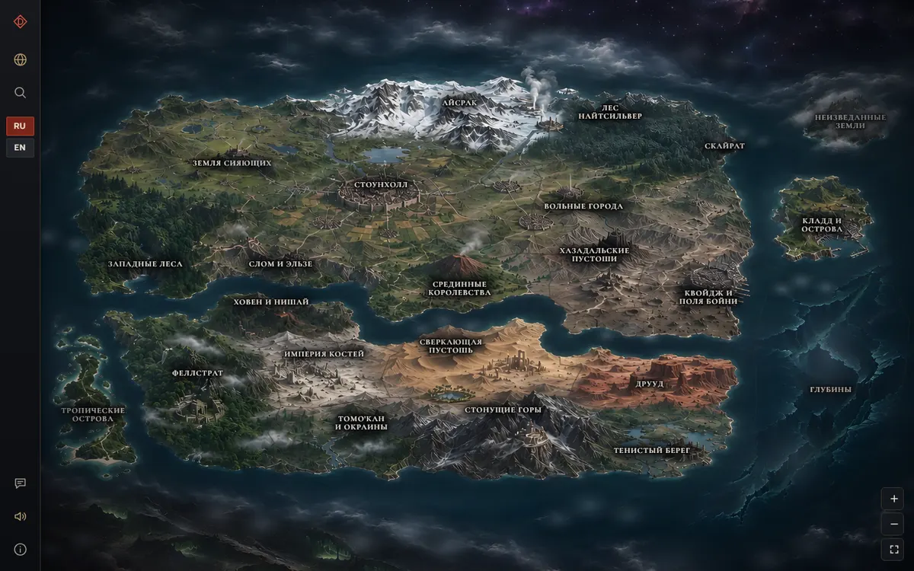

# Мир Dota 2 · Dota 2 World

**Сайт / Site:** https://shoralbrt.github.io/dota-lore-map/



[Русский](#русский) · [English](#english)

---

## Русский

Интерактивная карта лора Dota 2 — некоммерческий фанатский проект. Мир нарисован целиком: два материка, Верхний ярус и Бездна по углам, 27 регионов и 181 место. Карту можно свободно двигать и приближать; у региона — описание, места, герои и официальные медиа (комиксы, трейлеры, арты), у героя — профиль и путь по миру нитью через места его истории. Есть поиск по героям, регионам и местам, русский и английский языки, телефон и клавиатура.

### Запуск и проверка

Нужны Node 22 и Python 3.

```sh
npm ci           # зависимости
npm run dev      # сервер разработки
npm run check    # всё перед PR: данные, типы, линт, тесты, сборка, бюджет загрузки, превью, геометрия карты, Python
npm run e2e      # Playwright в Chromium, Firefox, WebKit и на телефоне (npx playwright install chromium firefox webkit)
```

После правки `research/`, `content/` или `map/layout.json` запустите `npm run data` и закоммитьте `src/data/world.generated.json` — CI проверяет, что файл актуален. Картинка превью для соцсетей — `node scripts/og-image.mjs` → `public/og.png`.

### Как устроены данные

Факты о мире — регионы, места, связи героев с местами и пути — лежат в `research/` и проверены по источникам; тексты регионов и мест на двух языках и список медиа — в `content/`. `npm run data` собирает их и схему мира в один `src/data/world.generated.json` и валидирует ссылки между ними. Модель данных — [ARCHITECTURE A3](docs/ARCHITECTURE.md#a3-данные).

Схема мира `map/layout.json` хранит полигоны регионов, подписи, камеры и позиции мест в долях стороны квадратного мира; она подогнана под растровый арт `map/art/world.jpg` и проверяется `node map/check-layout.mjs`. Камера, рамка региона и подписи — [A4](docs/ARCHITECTURE.md#a4-карта-и-камера), арт и плитки — [A10](docs/ARCHITECTURE.md#a10-арт-карты-и-предзагрузка).

Портреты героев и медиа не копируются в репозиторий: они грузятся с CDN Valve по ссылке, у каждого медиа указаны правообладатель и источник. Поиск и нити героев — [A11](docs/ARCHITECTURE.md#a11-поиск-и-нити), деплой и проверки — [A7](docs/ARCHITECTURE.md#a7-деплой-и-проверки). Полное техническое задание — [docs/SPEC.md](docs/SPEC.md).

### Нашли ошибку?

Кнопка обратной связи в левой панели сайта (или строка «Нашли ошибку или знаете больше?» под блоком) открывает готовый issue на GitHub с адресом и контекстом экрана. Можно и сразу [завести issue](../../issues/new). Сообщения публичны — не пишите в них личных данных.

### Лицензии

- Код и тексты проекта — [MIT](LICENSE), © shoraLBRT.
- Шрифты Cormorant SC и Manrope — SIL Open Font License 1.1 (`public/fonts/OFL-*.txt`).
- Материалы Valve (изображения, видео, названия героев и мест, товарные знаки) проекту не принадлежат и под MIT не попадают; сайт показывает их по ссылке на официальные источники.

**Дисклеймер.** Некоммерческий фанатский проект. Не связан с Valve Corporation и не одобрен ею. Dota 2 и связанные материалы — товарные знаки и собственность Valve Corporation.

---

## English

An interactive map of Dota 2 lore — a non-commercial fan project. The whole world is drawn: two continents, the Upper Tier and the Abyss in the corners, 27 regions and 181 places. Pan and zoom the map freely; a region shows its description, places, heroes and official media (comics, trailers, art), and a hero shows a profile and their path across the world as a thread through the places of their story. Search covers heroes, regions and places; the site speaks Russian and English and works on phones and from the keyboard.

### Run and check

You need Node 22 and Python 3.

```sh
npm ci           # dependencies
npm run dev      # dev server
npm run check    # everything before a PR: data, types, lint, tests, build, load budget, preview card, map geometry, Python
npm run e2e      # Playwright in Chromium, Firefox, WebKit and on a phone (npx playwright install chromium firefox webkit)
```

After editing `research/`, `content/` or `map/layout.json`, run `npm run data` and commit `src/data/world.generated.json` — CI checks that it is up to date. The social preview image is built by `node scripts/og-image.mjs` → `public/og.png`.

### How the data works

Facts about the world — regions, places, hero-to-place links and paths — live in `research/` and are checked against sources; region and place texts in both languages and the media list live in `content/`. `npm run data` merges them with the world layout into one `src/data/world.generated.json` and validates the references between them. The data model is in [ARCHITECTURE A3](docs/ARCHITECTURE.md#a3-данные) (the docs are in Russian).

The world layout `map/layout.json` stores region polygons, labels, cameras and place positions as fractions of the square world; it is fitted to the raster art `map/art/world.jpg` and checked by `node map/check-layout.mjs`. Camera, region framing and labels: [A4](docs/ARCHITECTURE.md#a4-карта-и-камера); art and tiles: [A10](docs/ARCHITECTURE.md#a10-арт-карты-и-предзагрузка).

Hero portraits and media are not copied into the repository: they load from Valve's CDN by link, and every media item names its rights holder and source. Search and hero threads: [A11](docs/ARCHITECTURE.md#a11-поиск-и-нити); deploy and checks: [A7](docs/ARCHITECTURE.md#a7-деплой-и-проверки). The full specification: [docs/SPEC.md](docs/SPEC.md).

### Found a mistake?

The feedback button in the site's left rail (or the “Spotted a mistake or know more?” line under a block) opens a prefilled GitHub issue with the address and screen context. You can also [open an issue](../../issues/new) directly. Reports are public — don't include personal data.

### Licenses

- The project's code and texts — [MIT](LICENSE), © shoraLBRT.
- Fonts Cormorant SC and Manrope — SIL Open Font License 1.1 (`public/fonts/OFL-*.txt`).
- Valve materials (images, videos, hero and place names, trademarks) do not belong to the project and are not covered by MIT; the site shows them by linking to official sources.

**Disclaimer.** Non-commercial fan project. Not affiliated with or endorsed by Valve Corporation. Dota 2 and all related materials are trademarks and property of Valve Corporation.
