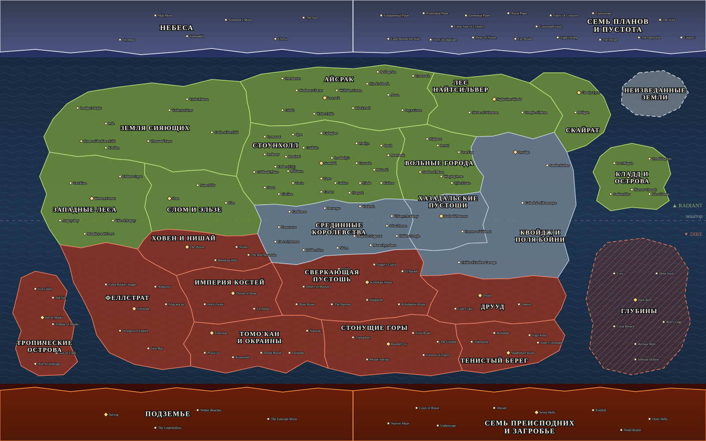

# E2 · Схема мира

| | |
|---|---|
| Эпик | #2 E2 · Арт карты |
| Статус | Арт мира готов (#163, `map/art/`), разметка подогнана под него; детальных картинок регионов нет (см. [ART-PROMPTS.md](ART-PROMPTS.md)) |
| Данные | [`map/layout.json`](../../map/layout.json) — полигоны, подписи, камеры, позиции мест (формат — ARCHITECTURE A3) |



Цвета условные: зелёный — Radiant, красный — Dire, серо-голубой — нейтральные регионы, звёздный угол справа вверху — Верхний ярус, огненный слева внизу — Бездна. Штриховка — подводный регион «Глубины», пунктир — «Неизведанные земли» в тумане. Ромб — столица или главное место региона, точка — остальные места.

## Как обновлять

```
node map/check-layout.mjs     # проверка геометрии; exit 1 при ошибке
node map/render-schema.mjs    # перерисовать docs/map/schema.svg
```

`check-layout.mjs` сверяет `layout.json` с `research/e1/regions.json` и проверяет:

- у каждого региона есть полигон из 8–30 вершин, координаты в `[0, 1]`, контур без самопересечений;
- полигоны регионов не пересекаются друг с другом (общие рёбра и вершины соседей — можно);
- мир квадратный (`aspect: 1`, поля `bands` нет); ярусы `upper` — в правом верхнем углу, `abyss` — в левом нижнем (вершины не дальше 0.75 от угла по каждой оси);
- `label` и каждое место — внутри полигона своего региона, не ближе 0.004 к краю;
- размещены все места из `regions.json`, лишних нет; между местами одного региона ≥ 0.012;
- у камеры `x, y ∈ [0, 1]`, `zoom ∈ [1, 8]`.

Расстояния — в нормированных координатах; мир квадратный, поэтому по обеим осям одинаково.

## Камера

`camera.zoom = z` означает: мир, вписанный в кадр, увеличен в `z` раз, то есть по меньшей стороне кадра видно `1/z` мира; в коде камера отдаляется ещё в 0.85 раза (`REGION_DISTANCE`, #165) и не бывает дальше «мир во весь кадр». Центр — центр габарита региона, `zoom = min(0.7 / высота габарита, 0.9 / ширина габарита)` в пределах 1.2–6 (#163). Правило «≈ 70 % кадра» пересматривается на рисунке в #112; `frameCamera` в коде дополнительно ужимает кадр под панель и не уводит его за край мира.

## Решения по географии

Координат в лоре нет, есть только относительные привязки (E1-places.md, раздел 2). Схема собрана так, чтобы не нарушать ни одну из них.

**Каркас (решение владельца 2026-11-18, #163).** Мир квадратный, 1:1. **Два материка**, между ними пролив с запада на восток: на севере — Radiant и центр, на юге — Dire (Ховен, Феллстрат, Империя Костей, Сверкающая пустошь, Друуд, Томо'кан, Стонущие горы, Тенистый берег). Вокруг — море, Тропические острова на западе, Кладд и Неизведанные земли на востоке, разлом Глубин — к востоку от материков. **Ярусы — в углах, а не полосами:** правый верхний угол — Небеса (ближе к миру) и Семь планов с Пустотой (в самом углу); левый нижний — Подземье (ближе к миру) и Семь Преисподних (в углу). Два других угла — открытое море. Относительные привязки лора ниже сохранены при переносе (проверено при построении основы `map/art/base/schema-base-v5.svg`).

**Север — Radiant, юг — Dire.** Так на официальной карте Source 1: Land of the Radiant на севере, Scorch of the Dire на юге. Поэтому:

- **Айсрак** — у северного побережья, самая северная суша. Хребет The Barrier — к северу от столицы, порт Frostreach и Кипящее море — на северном берегу.
- **Земля Сияющих** — северо-запад, **Лес Найтсильвер** — северо-восток.
- **Стонущие горы, Сверкающая пустошь** (с Desert of Misrule на её западе и Riftshadow Ruins) — юг материка. **Глубины** — открытое море на юго-востоке; это регион-полигон в море, а не суша.

**Цепочка Квойдж → Хазадал → Поля Бойни → Друуд.** Квойдж «далеко к северу от Полей», Хазадальские пустоши — «к северу от Полей», Друуд — «к югу от Полей». Поля Бойни входят в регион «Квойдж», поэтому регион сделан буквой «Г»: полоса вдоль восточного побережья (город Квойдж на севере, Smoke Harbor на берегу, в дне пути от него) и «стопа» к югу от Хазадала, где лежат Поля. Хазадальские пустоши — в изгибе этой буквы, Друуд — сразу под Полями. По y: Квойдж 0.345 → Хазадал 0.49 → Поля 0.595 → Друуд 0.67.

**Стоунхолл и Вольные города.** Кластер в центре севера. Города расставлены по сторонам света из лора: Tares и Sashire — к югу от столицы, Crester — к югу от Tares, Tarrin — к юго-западу, Roseleaf, Milltown (между Roseleaf и Tarrin), Ember, Redmaw (западнее Roseleaf) и Coldbank Plains — к западу, Lincastle и Mistmill — к востоку, Pinelyn — к северо-востоку, озеро Lightglass — к северу. Вольные города — сразу к востоку от границы империи и к северу от Хазадальских пустошей (как White Spire в лоре). Weeping Rose — соседний с White Spire город, таверна Sundered Moon — в White Spire.

**Запад — леса.** Западные леса на западном побережье, к востоку от них — Слом и Эльзе (Слом у границы с лесами, Эльзе — дальше, их связывает дорога). Ховен и Нишай — к югу, у подножия Bleeding Hills.

**Юго-запад — тропики.** Феллстрат (джунгли, Overgrown Empire, Ашкавор за горами Xhacatocatl) — на юго-западном побережье, Тропические острова — архипелаг в море напротив него. Империя Костей и Томо'кан с Окраинами — между Феллстратом и пустыней; пустыня Nanarak в Окраинах примыкает к Сверкающей пустоши, Кримвол — к югу от Томо'кана.

**Острова.** Кладд — островное государство в восточном море. Неизведанные земли — остров в тумане в северо-восточном углу, мест внутри нет (решение В1). Тенистый берег — юго-восточное побережье между Стонущими горами и морем; Tidemarsh на его западе связывает его со Стонущими горами.

**Срединные королевства** — в центре материка (решение В9): между Стоунхоллом, Хазадалом, Сверкающей пустошью и Ховеном.

**Скайрат** (#158) — королевство скайрасов на утёсах и шпилях северо-восточного побережья, к востоку от Леса Найтсильвер и к северу от Квойджа («Квойдж к югу от Skywrath»). В комиксах Crownfall оно на земле: армия входит через Lowland Gate, под скалой столицы Ghastly Eyrie лежит нижний город Midgate. Оба места перенесены сюда из Небес.

**Ярусы.** Небеса — кольцо между миром и Планами: луны и Солнце — ближе к миру, Олимп, Vashundol и Ультория — у Планов. Планы — угол: Пустота у самого угла, рядом Outworld «на краю Бездны», Cataract и Continuum Vault; дальше — планы бытия и родные миры пришельцев (Land Behind the Wall, Ivory Incubarium с Great Seat of Cymurri, Fae Realm). Подземье — кольцо у мира (Aziyog, Nether Reaches, Изумрудная бездна, Underhollow). Преисподние — угол: путь мёртвых Narrow Maze → Underscape ведёт от границы с Подземьем к углу, рядом — двор Ристула, которому лабиринт подчиняется.

## Сверка кандидатов (#59)

Кандидаты в места из партий E14 и комиксов разобраны по одному правилу:

- **Добавить** — у места есть событие героя (не только `mention`) из биографии, текста лор-страницы или комикса, и регион следует из источника или из соседнего места на схеме. Так появились Midgate, Moerbeek, Gale Crater, Magnetic Ziggurat, Court of Ristul, Fae Realm, Great Seat of Cymurri; по решению владельца (2026-11-18) — ещё Cataract и Continuum Vault в «Семи планах», хотя их положение в лоре не названо.
- **Объединить** — место лежит внутри уже нанесённого (таверна в городе, деревня на равнине, пещеры под островом, горы под храмом): оно уходит в `note` связи героя.
- **Отклонить** — только инфобокс или упоминание, а регион не назван: кандидат остаётся в `research/e1/place-candidates.json` до нового источника.

Точка нового места, сторона света которого в лоре не названа, — наша (свободное место в регионе). Таблица решений по каждому кандидату — в PR #156 (задача #59).

## Решение В10: стороны нейтральных регионов

Одобрено владельцем: сторона по положению на схеме, север — Radiant, юг — Dire. Положение региона — **центроид его полигона**:

- центроид севернее y = 0.47 → **Radiant**;
- южнее y = 0.53 → **Dire**;
- между ними — **экваториальный пояс, остаётся нейтральным**. В него попали Квойдж с Полями Бойни (регион тянется через экватор, а Поля — вечное поле боя как раз на границе половин), Хазадальские пустоши (земля безбожных изгоев, не признающих ничьей власти) и Срединные королевства (в центре материка). Пояс — естественная ничейная полоса между Radiant и Dire.

Ярусы и «Неизведанные земли» — нейтральные всегда. Где взята сторона — поле `sideBasis` в `research/e1/regions.json`: `s1map` (карта Source 1), `position` (это правило), `tier` (ярус).

| Регион | Сторона | Основание | Центроид y | Мест | Зум |
|---|---|---|---|---|---|
| Небеса · The Heavens | нейтрально | ярус | 0.06 | 6 | 1.4 |
| Семь планов и Пустота · The Seven Planes and the Void | нейтрально | ярус | 0.06 | 17 | 1.4 |
| Айсрак · Icewrack | Radiant | карта S1 | 0.22 | 12 | 2.5 |
| Земля Сияющих · Land of the Radiant | Radiant | карта S1 | 0.29 | 8 | 2.39 |
| Лес Найтсильвер · Nightsilver Woods | Radiant | карта S1 | 0.24 | 3 | 3.65 |
| Скайрат · Skywrath | Radiant | положение | 0.25 | 2 | 3.9 |
| Стоунхолл · Stonehall | Radiant | положение | 0.37 | 25 | 2.94 |
| Вольные города · The Free Cities | Radiant | положение | 0.37 | 7 | 4.05 |
| Кладд и острова · Cladd and the Isles | Radiant | положение | 0.40 | 6 | 4.58 |
| Западные леса · Western Forests | Radiant | положение | 0.45 | 6 | 3.18 |
| Слом и Эльзе · Slom and Elze | Radiant | положение | 0.46 | 3 | 4.24 |
| Квойдж и Поля Бойни · Quoidge and the Fields of Carnage | нейтрально | положение | 0.48 | 4 | 2.1 |
| Хазадальские пустоши · Hazhadal Barrens | нейтрально | положение | 0.50 | 2 | 5 |
| Срединные королевства · The Middle Kingdoms | нейтрально | положение | 0.52 | 12 | 3.04 |
| Неизведанные земли · The Uncharted Lands | нейтрально | положение (туман) | 0.21 | 0 | 5 |
| Ховен и Нишай · The Hoven and Nishai | Dire | положение | 0.57 | 4 | 3.68 |
| Сверкающая пустошь · Scintillant Waste | Dire | карта S1 | 0.65 | 9 | 2.98 |
| Империя Костей · Empire of Bone | Dire | положение | 0.67 | 3 | 4.67 |
| Друуд · Druud | Dire | положение | 0.68 | 3 | 3.38 |
| Феллстрат · Fellstrath | Dire | положение | 0.69 | 6 | 2.43 |
| Глубины · The Deep | Dire | карта S1 | 0.69 | 7 | 2.26 |
| Тропические острова · Tropic Isles | Dire | положение | 0.74 | 7 | 2.95 |
| Тенистый берег · Shadeshore | Dire | положение | 0.78 | 5 | 4.52 |
| Томо'кан и Окраины · Tomo'kan and the Outlands | Dire | положение | 0.78 | 6 | 3.41 |
| Стонущие горы · Wailing Mountains | Dire | карта S1 | 0.79 | 6 | 3.5 |
| Подземье · The Underdark | нейтрально | ярус | 0.94 | 4 | 1.4 |
| Семь Преисподних и загробье · The Seven Hells and the Afterlife | нейтрально | ярус | 0.94 | 8 | 1.4 |

Итого: Radiant — 9 регионов, Dire — 10, нейтральных — 8 (4 яруса, экваториальный пояс из 3 регионов, Неизведанные земли).

## Что дальше

- Детальные картинки регионов по [ART-PROMPTS.md](ART-PROMPTS.md) (#111), подписи и кадр на рисунке (#112), свободная камера — #165, плитки — #164, постэффекты — #167.
- Арт мира (#163): исходник `map/art/world.jpg` (5016×5016, JPEG), основа генерации — `map/art/base/` (README там же), варианты и снимки приближения — `map/art/variants/`. Разметку подгоняли скриптами `map/art/fit/` (README там же): маска суши по цвету → береговая линия → береговые рёбра полигонов заменены упрощённым контуром; места ярусов разложены по углам; несколько мест поправлены руками. Наложение и снимки — [e2-163/](e2-163/overlay.webp).
- Под новый рисунок полигоны правятся в `layout.json`, затем `node map/check-layout.mjs` и `node map/render-schema.mjs`.
