# Плитки арта мира (#164)

Файл создаёт `node map/art/tiles.mjs cut` — руками не править, перезапуск перепишет. Как устроены скрипты — [docs/map/README.md](../../../docs/map/README.md), раздел «Плитки арта».

Исходник `map/art/world.jpg` (5016×5016) разрезан сеткой 4×4, у каждой плитки перекрытие с соседями 128 px. Плитки — в `map/art/tiles/cut/` (в Git не хранятся: после свежего клона сначала `cut`).

## Инструкция владельцу

1. `npm ci`, затем `node map/art/tiles.mjs cut` — появятся `map/art/tiles/cut/r{ряд}c{столбец}.png`.
2. Каждую плитку с пометкой **дорисовать** (таблица ниже) прогнать через **creative upscale ×2 с низкой креативностью**:
   - **Krea Enhancer**: upscale ×2, creativity / strength 0.2–0.3, resemblance высокий;
   - или **Stable Diffusion + Ultimate SD Upscale** с ControlNet **tile** (вес 0.8–1.0), denoising 0.25–0.35, апскейлер 4x-UltraSharp или ESRGAN, тайл 1024, seam fix — band pass.
   - **Не ChatGPT** и не другие генераторы «по образу»: они сдвигают берега, и плитка не пройдёт проверку.
   - Промпт один для всех плиток (ниже), сид — один и тот же.
3. Результат сохранить в `map/art/tiles/refined/` под тем же именем (`r1c2.png`, PNG или WebP). Размер — примерно ×2 от плитки; точный не важен, сборка подгонит. Плитки с пометкой «не дорисовывать» не нужны: на их месте будет увеличенный исходник.
4. `node map/art/tiles.mjs stitch` — собирает мастер и печатает сдвиг берегов по каждой плитке. Плитку со сдвигом больше 0.3 % ширины мира переделать (ниже creativity) и запустить снова.
5. `node map/art/tiles.mjs pyramid` — тайлы в `public/map/tiles/`, манифест `src/features/world/tiles.json` и новый `public/art/world-4096.webp`. Затем `npm run check` и PR с этими файлами.

Дорисованные плитки и мастер в Git не идут (`.gitignore`, сотни мегабайт): сохраните `refined/` у себя, чтобы пересобрать позже.

### Промпт

```
Realistic fantasy world seen from orbit, strictly top-down satellite imagery, rich natural relief:
sharp mountain ridges, river valleys, forests, glaciers, deserts, coastlines with surf, cities at map scale.
Dark fantasy mood, Dota 2 inspired palette. Keep every coastline, river and city exactly where it is.
No text, no letters, no labels, no runes, no frame, no border, no watermark, no moons.
```

Отрицательный промпт (SD): `text, letters, watermark, frame, border, moon, blurry, painting, cartoon`.

## Плитки

«Ровно» — доля спокойных блоков (море, космос); от 80 % плитку не дорисовываем.

| Плитка | Превью | Размер, px | Ровно | Что делать |
|---|---|---|---|---|
| r0c0 | 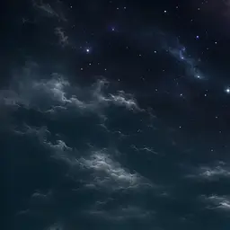 | 1382×1382 | 81 % | не дорисовывать |
| r0c1 | 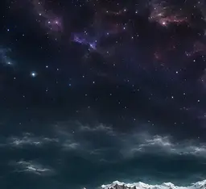 | 1510×1382 | 77 % | **дорисовать** |
| r0c2 | 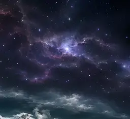 | 1510×1382 | 64 % | **дорисовать** |
| r0c3 | 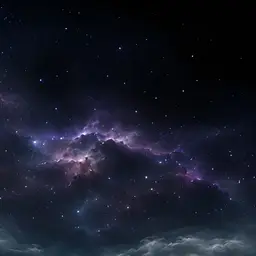 | 1382×1382 | 78 % | **дорисовать** |
| r1c0 | 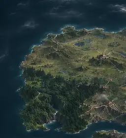 | 1382×1510 | 40 % | **дорисовать** |
| r1c1 | 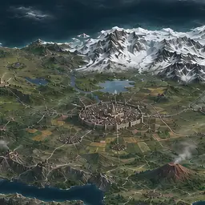 | 1510×1510 | 17 % | **дорисовать** |
| r1c2 | 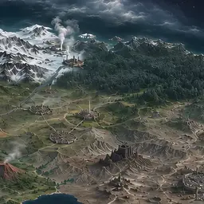 | 1510×1510 | 12 % | **дорисовать** |
| r1c3 | 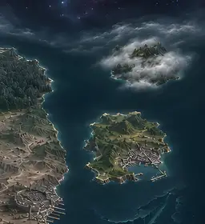 | 1382×1510 | 48 % | **дорисовать** |
| r2c0 | 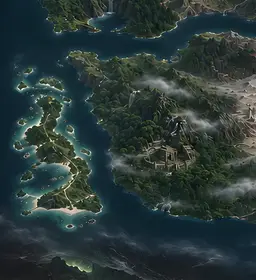 | 1382×1510 | 35 % | **дорисовать** |
| r2c1 | 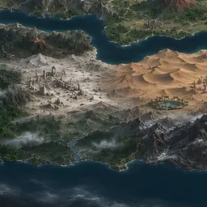 | 1510×1510 | 25 % | **дорисовать** |
| r2c2 | 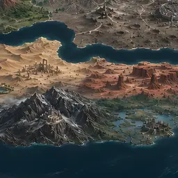 | 1510×1510 | 25 % | **дорисовать** |
| r2c3 | 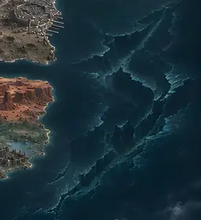 | 1382×1510 | 62 % | **дорисовать** |
| r3c0 | 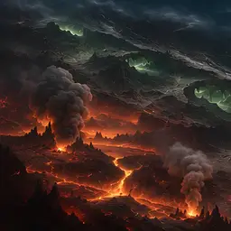 | 1382×1382 | 49 % | **дорисовать** |
| r3c1 | 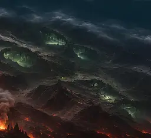 | 1510×1382 | 60 % | **дорисовать** |
| r3c2 | 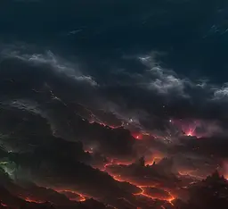 | 1510×1382 | 74 % | **дорисовать** |
| r3c3 | 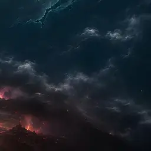 | 1382×1382 | 81 % | не дорисовывать |
